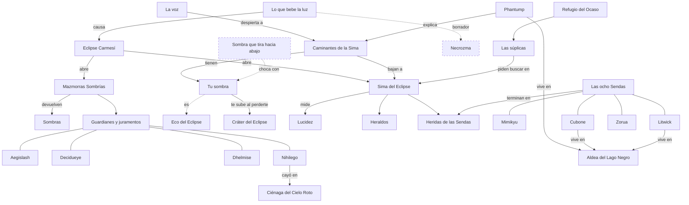

# Biblia del lore de Mazmorra Sombría

*(27-10-2026. Registro de lo que existe, no invención. Fuente del texto del jugador: `src/i18n/es.json`; las claves se citan en `código` y se pueden buscar tal cual. El resto se cita como `ruta:línea`. Grafo: `docs/lore/lore-graph.json`, visor: `docs/lore/lore-graph.html`, comprobación: `node tools/lore-graph-check.mjs`. Prácticas aplicadas en la auditoría: `docs/lore/buenas-practicas.md`.)*

## Cómo leer este documento

**Niveles de canon** (práctica 19 de `docs/lore/buenas-practicas.md`):

| Nivel | Qué es | Marca |
|---|---|---|
| **Núcleo** | La premisa que sostiene todo lo demás y que el juego dice en su apertura o en la Sima. Cambiarlo obliga a revisar todo. | [N] |
| **En el juego** | Texto o regla que el jugador puede ver hoy (está en `es.json` y se usa, o es una regla del código). | [J] |
| **Borrador** | Solo en documentos de diseño (`docs/*.md`, comentarios de código) o pendiente de decisión. No es canon. | [B] |

Cómo llega cada hecho al jugador: **se juega** (una regla que se nota jugando), **se lee** (texto en pantalla) o **solo diseño** (no llega al jugador).

**Regla de la casa** (`docs/sima-redesign.md:31`, `docs/gdd.md:421`): «lo mecánico sale de la semilla; lo narrativo sale de tu memoria». El mismo jefe para todos; lo que cambia es el nombre y el texto que ves según lo que has vivido.

---

## 1. Premisa del mundo

- [N] Hubo una edad en que «el sol no conocía la sombra» (`prologue.light.1`). Bajo la tierra algo despertó con hambre de luz, bebió del sol «hasta dejarlo hueco» (`prologue.hunger.1`, `prologue.dimming.1`), y llegó el **Eclipse Carmesí**: «Un anillo rojo sobre la nada. Desde entonces, no se ha movido.» (`prologue.eclipse.2`). Se lee (prólogo, `src/data/prologue.ts:42-61`).
- [N] Con el Eclipse se abrieron las **Mazmorras Sombrías**, «bocas de piedra que la víspera no estaban allí» (`prologue.dungeons.2`). «Los que volvieron ya no eran ellos. Solo su sombra.» (`prologue.shadows.2`). Por eso los enemigos son versiones sombrías (`docs/gdd.md:225`). Se lee y se juega.
- [N] Cada mazmorra tiene un **guardián** «atado a un juramento que ya nadie recuerda», y «más hondo que todas ellas, algo sigue devorando la luz» (`prologue.guardians.1`, `prologue.guardians.2`).
- [N] Una **voz** pregunta «…¿Me oyes? ¿Puedes oírme?» (`prologue.voice.1`) y abre el test de personalidad: «Estás a punto de despertar en un mundo que no es el tuyo.» (`quiz.intro.2`). El test termina en «¡Eres un {species}!» (`quiz.result.species`), siempre uno de los cuatro iniciales: Mimikyu, Zorua, Litwick o Cubone (`src/data/quiz.ts:18`). Es la premisa de Mundo Misterioso (humano que despierta como Pokémon).
- [N] **Por qué estamos aquí: los Caminantes de la Sima** (`lore.reborn.name`; decisión del dueño, `docs/sima-redesign.md:11`). Phantump lo explica la primera vez que te pierdes en la Sima: «Antes de despertar aquí erais gente. Una voz os preguntó si la oíais, y contestasteis.» (`sima.scene.lost.8`); «Despertasteis dentro de un Pokémon, con sus recuerdos y sus heridas. Y con una sombra que no os suelta.» (`sima.scene.lost.9`). Todo Pokémon jugable es una persona renacida (`docs/gdd.md:422`). Se lee.
- [N] **Por qué bajamos a la Sima**: a por los que no volvieron (`docs/sima-redesign.md:7`). «Todo lo que no volvió de las mazmorras acaba cayendo por aquí. Tú puedes volver. Por ahora.» (`dungeon.eclipse.lore.1`). En el pueblo te piden por favor que busques a alguien (las súplicas, `src/data/sima-plea.ts:22-30`). Se lee y se juega.

## 2. Cosmología y reglas del mundo

| Regla | Qué dice | Nivel | Cómo llega | Fuentes |
|---|---|---|---|---|
| El Eclipse no se mueve | Anillo rojo quieto; el mundo exterior está siempre al anochecer del eclipse | [N] | Se lee y se ve (cielo de todos los mapas) | `prologue.eclipse.2`; `docs/gdd.md:511` |
| Las mazmorras devuelven sombras | Quien entra y vuelve ya no es él, solo su sombra; los enemigos son sombras | [N] | Se lee; se juega (enemigos) | `prologue.shadows.2`; `town.story.2`; `docs/gdd.md:225` |
| Guardianes y juramentos | Cada mazmorra tiene un guardián atado a un juramento olvidado; al caer, el juramento se rompe y otro lo siente | [J] | Se lee (cinemáticas de guardián) | `prologue.guardians.1`; `guardian.aegislash.post.1`; `world.lore.crater.2` |
| Algo bebe la luz | Bajo la tierra (prólogo) o «más allá de vuestro cielo» (Nihilego); nunca se nombra | [N] | Se lee | `prologue.hunger.1`; `guardian.nihilego.post.2`; `guardian.dhelmise.post.2` |
| La Sima baja hacia el eclipse | No hacia el fondo de la tierra: «Allí abajo está el otro cielo»; la luz cae y nunca toca fondo | [J] | Se lee (Phantump) y se ve (Estrato V: el anillo debajo) | `sima.scene.lost.11`, `sima.scene.lost.12`; `sima.band.abyss.lore.2`; `docs/gdd.md:423` |
| Reencarnación | Gente que contestó a la voz despierta dentro de un Pokémon con sus recuerdos y heridas | [N] | Se lee | `quiz.intro.2`; `sima.scene.lost.8`, `sima.scene.lost.9` |
| La sombra propia | Todo Caminante tiene «una sombra que no os suelta»; cuando te pierdes, tira de ti hacia arriba; «A los que bajan sin una, la Sima se los queda» | [J] | Se lee (súplicas, punto de quiebre, pantalla final) | `sima.scene.lost.9`, `sima.scene.lost.10`; `sima.plea.oracle.2`; `screen.eclipse.text` |
| No tentar a la sombra | Hay Caminantes que bajaron tanto que su sombra ya no supo encontrarlos | [J] | Se lee | `sima.scene.lost.13`; `sima.plea.hermit.2`, `sima.plea.hermit.3` |
| Lucidez | El reloj de la Sima: cuánto aguantas siendo tú. Empieza en 8:00, bajar suma (40 s, menos con la profundidad, mínimo 15 s), vencer un eco suma 60 s; a las 0:00 «te pierdes» | [J] | Se juega (HUD «LUCIDEZ») y se lee | `endless.entry.clock`; `endless.score.time`; `docs/gdd.md:387`, `docs/gdd.md:424` |
| Te pierdes, no mueres | A las 0:00 tu sombra te sube al borde del cráter; es una marca, no una derrota | [J] | Se juega y se lee | `screen.eclipse.title`, `screen.eclipse.text`; `docs/sima-redesign.md:8` |
| Estratos como etapas de la caída | I Lo que conoces, II Lo que temes, III Lo que nombras, IV Lo que no es tuyo, V Lo que queda de ti | [J] | Se lee (tarjetas, cinemáticas) y se ve | `sima.band.*.subtitle`; `docs/gdd.md:425` |
| El Eco del Eclipse | «La parte de ti que el eclipse ya se ha bebido»: tu forma, hueca y roja, crece en cada encuentro | [J] | Se juega (jefe de las plantas 10, 20...) y se lee | `sima.scene.own-shadow.3`; `sima.echo.line.1`; `docs/gdd.md:405-406` |
| Heraldos | Nombres que tu cabeza se inventa: «A lo que no se entiende, la cabeza le pone nombre» | [J] | Se juega (plantas 22, 32...) y se lee | `sima.scene.stratum-caves.1`; `sima.scene.first-name.2`; `docs/gdd.md:407-413` |
| Memoria | Lo que no conoces sale sin cara: Guardián sin rostro, Sombra de alguien, Una herida que no es tuya | [J] | Se lee (nombre, silueta) | `species.sima-faceless`, `species.sima-someone`, `species.sima-not-yours`; `src/app/sima-lore.ts:11-18` |
| Figuraciones | Con menos de 60 s de Lucidez, siluetas de alguien que no está en el borde de la vista; nunca dañan | [J] | Se ve (solo presentación) | `docs/gdd.md:432`; `menu.figurations` |
| El Eco | Ver «El Eco del Eclipse» (arriba) y «El Eco» en el glosario: «eco» nombra tres cosas distintas | [J] | — | Glosario |
| Hogueras y niebla | Antes de cada jefe, un muro de niebla; vencido el intermedio, una hoguera a la que volver | [J] | Se juega | `leave.fog.title`; `bonfire.lit`; `docs/gdd.md:59` |
| Evolución y despertar | Las hace Phantump con Esencias de los retos; Mimikyu no evoluciona: despierta | [J] | Se juega | `world.npc.oracle.evolve`; `evolve.awaken.row`; `docs/gdd.md:1012`, `docs/gdd.md:1021` |
| Las sombras no vuelan | Un jefe sombra con alas cambia Volador por Fantasma | [J] (regla) / se lee una vez | Se lee en Cubone I | `story.cubone.1.boss.6.post.1`; `docs/story-quests.md:52` |
| Arriba y abajo se tocan | El «otro cielo» de Nihilego y el «bajo la tierra» del prólogo son el mismo sitio visto desde los dos lados | [B] (dicho a medias en el juego) | Solo diseño; el juego solo dice «Allí abajo está el otro cielo» | `docs/sima-redesign.md:96`; `sima.scene.lost.12` |

## 3. Lugares

El mundo exterior es pequeño, se recorre andando, siempre al anochecer del eclipse y sin combate (`docs/gdd.md:511`).

- **Refugio del Ocaso** [J] (`world.map.refugio`): el pueblo de partida. Mimikyu (puesto de la suerte), Poochyena (tienda; «Desde el Eclipse Carmesí la fragua no prende sola», `town.shop.1`), Gastly (cuentacuentos, `town.story.1-4`), Smeargle (maestro de movimientos, `town.tutor.1`), el tablón, el Pilar de las señales («Una llama fría arde en la piedra», `town.beacon.1`) y el **Santuario de los Juramentos** («Donde los guardianes vuelven a jurar», `shrine.subtitle`; «Cada guardián que cae deja aquí su juramento», `shrine.text`). `src/data/town.ts:203-206`, `src/data/world.ts:136-143`.
- **Camino de las Ruinas** [J] (`world.map.ruinas`): tumbas y columnas; la Estatua sin rostro («El que juró la espada no la soltará jamás», `world.lore.knight.1`, que cambia al caer el Rey, `world.lore.knight.2`); el poste («No bajes solo», tachado: «Volvió», `world.lore.sign.2`). Boca de la Cripta. `src/data/world.ts:156-199`.
- **Paso del Mirador** [J] (`world.map.mirador`): una grieta y un solo puente; el eclipse «cada noche parece un poco más cerca» (`world.lore.view.1`). Boca del Bosque Brumoso. `src/data/world.ts:205-253`.
- **Cráter del Eclipse** [J] (`world.map.crater`): ceniza bajo el eclipse; la boca de la Sima; la Estatua quemada, «con las manos quemadas, como si hubiera intentado sujetar el sol» (`world.lore.crater.1`); «La sima no tiene fondo. Solo más eclipse» (`world.lore.crater.3`). Aquí se hacen las súplicas y despiertas al perderte. `src/data/world.ts:259-292`, `src/data/sima-plea.ts:41`.
- **Aldea del Lago Negro** [J] (`world.map.lago`): pescadores; «Esta aldea vivía de la luz del lago. Cuando el sol se apagó, el agua se volvió negra.» (`world.npc.keeper.1`); «El lago ya no refleja el cielo. Refleja lo que hay debajo.» (`world.npc.fisher.2`). Cubone pesca, Litwick guarda la llama, Phantump ve lo que vendrá; un ídolo de rana recibe ofrendas (`world.lore.idol.1-3`). La casa grande con todas las lámparas encendidas está «al final de la aldea» (`story.litwick.1.before.1`). Boca de las Cuevas Inundadas al final del embarcadero. `src/data/world.ts:299-350`.
- **Ciénaga del Cielo Roto** [J] (`world.map.cienaga`): donde cayó la primera gota de luz roja (`world.npc.hermit.2`); el Cristal caído que muestra «un cielo que no es este» (`world.lore.crystal.2`) y luego suena «como una puerta que alguien, desde el otro lado, empuja» (`world.lore.crystal.3`). Croagunk, el ermitaño. Boca del Pantano. `src/data/world.ts:359-413`.
- **Las mazmorras principales** [J] (`src/data/dungeon-lore.ts:18-53`):
  - *Cripta del Rey de las Espadas*, «Donde el acero aún espera órdenes»: el Rey guarda una puerta sellada; «Nadie sabe si protege al mundo de lo que hay detrás, o a lo que hay detrás del mundo.» (`dungeon.crypt.lore.2`). Jefes: Sableye (intermedio) y Aegislash.
  - *Bosque Brumoso*, «Donde la niebla es el aliento de los perdidos»: «Quien se pierde en la niebla no vuelve: echa raíces, y escucha.» (`dungeon.forest.lore.1`). Jefes: Trevenant y Decidueye.
  - *Cuevas Inundadas*, «Donde la campana ahogada aún llama a los suyos»: un santuario hundido bajo el Lago Negro, su campana suena en cada eclipse (`dungeon.caves.lore.1`). Jefes: Lanturn y Dhelmise.
  - *Pantano Tóxico*, «Donde la luz del eclipse goteó de otro cielo»: «Aquí cayó la primera gota de la luz roja. El agua la bebió, y se volvió veneno.» (`dungeon.swamp.lore.1`). Jefes: Salazzle y Nihilego. Primer aviso claro de que el eclipse vino de fuera (`docs/gdd.md:436`).
- **Sima del Eclipse** [J] (`dungeon.eclipse.name`, «Donde la luz cae y nunca toca fondo»): sin fondo, abierta desde el principio. Estratos (`src/data/sima.ts`; `docs/gdd.md:393`):
  - I · Ecos de la Cripta (1-10), *Lo que conoces*: «Algo baja contigo. No hace ruido. Solo te imita.» (`sima.band.crypt.lore.2`).
  - II · Raíces del Bosque Hundido (11-20), *Lo que temes*: «Aquí empieza a parecerte que algo te mira.» (`sima.band.forest.lore.2`).
  - III · La Campana Ahogada (21-30), *Lo que nombras*: «La campana del pecio suena bajo tus pies. O sobre tu cabeza.» (`sima.band.caves.lore.2`).
  - IV · El Cielo Envenenado (31-40), *Lo que no es tuyo*: «Ya no ves tus miedos. Ves los de los que bajaron antes.» (`sima.band.swamp.lore.2`).
  - V · El Abismo bajo el Anillo (41+), *Lo que queda de ti*: islas sobre la nada; «A lo lejos se recortan las torres de un reino que se hundió entero.» (`sima.band.abyss.lore.3`); «Lo único que te sostiene es tu nombre. No lo sueltes.» (`sima.band.abyss.lore.5`).
- **Lugares de las Sendas** [J], que no están en el mapa del mundo: la plaza de antes del Eclipse con su columpio (Mimikyu II), la torre sin techo «más allá de la cripta» (`story.cubone.3.before.1`), la casa grande (Litwick II), la fuente de la aldea (`story.zorua.1.before.1`), la niebla blanca «más allá del pantano» (`story.zorua.3.before.1`), el lago helado de Piplup, la manada al borde de la tormenta (Shinx II), la barranca y su árbol viejo de marcas (Axew).
- **Tierras sin nombre** [J]: «Más allá del lago hay tierras que aún no tienen nombre. Algún día el camino seguirá.» (`world.npc.oracle.2`).

## 4. Personajes y facciones

### Los del pueblo

| Personaje | Papel | Lo que sabemos | Fuentes |
|---|---|---|---|
| **Phantump**, la vidente del Lago | Evoluciona y despierta Pokémon; cierra las Sendas con una línea; explica qué son los Caminantes | «Las almas viejas sabemos esperar.» Te espera en el borde: «Y si te pierdes, te espero aquí, en el borde.» | `world.npc.oracle.evolve`; `sima.plea.oracle.3`; `sima.scene.lost.7-14`; `travel.at` |
| **Gastly**, cuentacuentos (Refugio) | Cuenta el prólogo; reconoce a los Caminantes «en los ojos» | Busca una manada de zorros que cruzó la niebla del bosque y no salió | `town.story.1-4`; `sima.plea.storyteller.1-5` |
| **Cubone**, pescador (Lago) | Pesca sin cebo | Su madre bajó a las cuevas a por luz la noche del Eclipse; volvió su hueso | `world.npc.fisher.1-2`; `sima.plea.fisher.1-3` |
| **Litwick**, «Guardiana de la llama» (Lago) | Guía a los perdidos hasta la orilla | Busca al niño que llevó de la mano; mantiene la casa grande encendida | `world.npc.keeper.1-4`; `sima.plea.keeper.1-3` |
| **Poochyena**, tienda (Refugio) | Fragua y mejoras | Su hermana mayor, una Mightyena con una muesca en la oreja, dejó de volver | `town.shop.1`; `sima.plea.shop.1-3` |
| **Mimikyu**, puesto de la suerte (Refugio) | El gacha («Cada cápsula trae a alguien nuevo, y yo quiero muchos amigos») | Busca a alguien que empujaba el columpio de la plaza aunque nadie se subiera | `town.gacha.1`; `sima.plea.gacha.1-2` |
| **Croagunk**, ermitaño de la ciénaga | Avisa del agua negra | Vio a una Caminante volver once veces; la duodécima solo subió su sombra | `world.npc.hermit.1-3`; `sima.plea.hermit.1-3` |
| **Smeargle**, maestro de movimientos | Tutor | «Cada Pokémon guarda en su sangre los movimientos de su tierra.» | `town.tutor.1` |

### Guardianes (atados a juramentos)

| Guardián | Título | Lo que dice | Fuentes |
|---|---|---|---|
| **Aegislash** | El Rey de las Espadas | «Soy el primero de los que guardan.» / «esta no era la única puerta» | `guardian.aegislash.*` |
| **Decidueye** | El Arquero de la Niebla | «Velo esta puerta desde que el sol se apagó.» / «Bajo las raíces algo sigue bebiendo la luz.» | `guardian.decidueye.*` |
| **Dhelmise** | El Ancla de los Juramentos Hundidos | «Juré guardar a los que se hundieron conmigo.» / «La campana sonaba para avisaros.» | `guardian.dhelmise.*` |
| **Nihilego** | «La que cayó por la grieta del cielo» | «Vengo de un cielo sin sol. Allí la luz se quebró, y su hambre os alcanzó.» / «Al otro lado aún quedan muchos, mirando por la grieta.» | `guardian.nihilego.*` |

Los cuatro tienen cinemática antes y después (`src/data/guardian-cinematics.ts:60-66`). Los **jefes intermedios** (Sableye «el ladrón de gemas», Trevenant, Lanturn «el farol del abismo», Salazzle «la reina de la ponzoña») tienen título en el GDD y nombres de carta, pero no texto de lore propio en `es.json` (`docs/gdd.md:254`, `docs/gdd.md:356`, `docs/gdd.md:450`). Trevenant reaparece en Axew II como el que salvó a Axew (`story.axew.2.after.2`). **Necrozma** es el jefe final previsto, nunca nombrado ni mostrado [B] (`docs/gdd.md:231`).

### Lo que hay en la Sima

| Figura | Qué es | Fuentes |
|---|---|---|
| **Tu sombra / Eco del Eclipse** | Tu forma en negro y rojo, «La sombra que bajó contigo»; la parte de ti que el eclipse se ha bebido; crece en cada encuentro | `sima.echo.subtitle`; `sima.scene.own-shadow.1-4`; `docs/gdd.md:405-406` |
| **Ecos de guardián / Guardián sin rostro** | Lo que sabes de los guardianes; sin cara si no lo has vencido: «Tu cabeza no tiene con qué darle cara» | `endless.echo`; `endless.echo.faceless`; `docs/gdd.md:426` |
| **Heraldos del Eclipse** | Jefes generados con nombres que nadie ha dicho nunca («Vaelorion, la Viuda de los Relojes Perdidos») | `species.sima-herald`; `sima.scene.first-name.1-2`; `src/data/herald-words.ts:1-30` |
| **Sombra extraviada / Sombra de alguien** | La sombra de una Senda: «No es quien era. Es lo que el eclipse se quedó.» Optativa | `sima.scene.someone.1-3`; `sima.stray.log.known`; `docs/gdd.md:428` |
| **Herida ajena / Una herida que no es tuya** | La herida de una Senda en las plantas 35, 55, 75... «La herida de {line}. {line} la cerró. Esta se quedó abajo.» | `sima.wound.log.known`; `sima.wound.log.nameless`; `docs/gdd.md:427` |
| **Sabueso del Eclipse** | Perseguidor imbatible; solo se huye | `sima.log.hunter.loosed`; `docs/gdd.md:403` |
| **Eco mercader** | «El eco te ve marchar sin decir nada.» | `sima.merchant.leaveText` |
| **Altar del Eclipse** | Pactos: «El eclipse da y el eclipse quita.» | `sima.log.shrine.accepted` |

### Las ocho líneas jugables (herida de cada una)

Iniciales (test de personalidad): Mimikyu, Zorua, Litwick, Cubone (`src/data/quiz.ts:18`). Del gacha: Abra, Piplup, Shinx, Axew (`docs/gdd.md:1027-1030`).

| Línea | Herida (trauma) | Mentira que se cuenta | Jefe final (su herida hecha carne) |
|---|---|---|---|
| Mimikyu | Lo vieron debajo del trapo y el que miró enfermó | «Si me ven, me dejarán de querer» | Mimikyu Sin Disfraz |
| Cubone | Su madre bajó a por luz; volvió su cráneo | Llorar dentro del hueso para que no se oiga | Marowak Sin Lágrimas |
| Litwick | Guió a un niño a casa comiéndose un poco de su vida | «¿Y si soy un trocito de lo que se come la luz?» | Chandelure de Llamas Ajenas |
| Zorua | Por miedo se hizo niño; su manada pasó sin reconocerlo | «Si los llamo con mi voz y no vienen, ya no podré pensar que no me oyeron» | Zoroark de Niebla Blanca |
| Abra | Soñó el Eclipse una semana antes y huyó sin avisar | Dormir para no verlo | Alakazam Desvelado |
| Piplup | Cayó por el hielo; lo sacó la vieja Empoleon y nunca le dio las gracias; ella no volvió | «No necesito ayuda» | Empoleon de Hielo Negro |
| Shinx | Asustó a su madre con su trueno; ella se fue a buscar a los perdidos y no volvió | Tragarse los truenos | Luxray Sin Párpados |
| Axew | Siguió a los mayores, cayó, se melló el colmillo; ellos no volvieron | Medirse con ellos | Haxorus de Colmillos Rotos |

(La columna «Mentira» es una lectura de esta biblia sobre líneas del juego, no un texto del juego; las citas están en la sección 5.)

## 5. Las ocho Sendas

Estructura común [J] (`docs/story-quests.md:18-67`): tres capítulos (I Normal, II Difícil, III Pesadilla), siete plantas, dos jefes intermedios (casi siempre **sombras**) y **la herida**, el propio Pokémon enorme y corrompido. Cinemática antes y después, voz interior, dos fragmentos de memoria, una línea de vínculo por capítulo y la línea de Phantump al cerrar el III, que lleva a la evolución final o al despertar. Cada capítulo recorre el camino de otra mazmorra (`src/data/story/*.ts`, `*_ROADS`). En todas, «tú» acompañas al Pokémon («Baja contigo...», `challenge.*.lore`): ver la contradicción C1.

### Mimikyu, La Senda del Disfraz («Lo que hay debajo»)

Fuentes: `docs/story-quests.md:77-91`, `story.mimikyu.*` (`src/i18n/es.json:2305-2386`), `src/data/story/mimikyu.ts`.

- **Antes**: se cosió el trapo para ir a la plaza; «Una tarde sopló el viento. El trapo se levantó un instante. Uno de los pequeños miró debajo.» (`story.mimikyu.2.before.3`). «Cuando llegó el Eclipse, los de la plaza se volvieron sombra. Mimikyu no. Él ya lo era.» (`story.mimikyu.3.before.1`).
- **I. El trapo** (camino de la Cripta): baja «por los materiales», lo dice dos veces. Jefes: Ditto, *El que no tiene cara* («a un charco no lo abraza nadie»), y Noctowl, *El sabio que no parpadea*. Herida: *Lo que no quiere ser visto*. Final: cose el cuello ante un espejo roto; «Te has dado la vuelta antes de que te lo pidiera.»
- **II. La plaza** (Bosque): Jigglypuff, *La canción que nadie esperó*; Pikachu, *El que todos abrazan*. Herida: *El viento que levanta el trapo*. Final: «El pequeño no enfermó por lo que vio. Enfermó de miedo.» (`story.mimikyu.2.after.2`); te ata una cinta roja.
- **III. Lo que hay debajo** (Cuevas): Polteageist, *La grieta que no se enseña*; Hatterene, *La que no soporta lo que sientes*. Herida: **Mimikyu Sin Disfraz**, un brazo negro que «se acuerda de cada nombre de la lista»; última palabra «Ya Me Has Visto». Resolución: lo abraza; el disfraz cae y no lo recoge; «Lo que viste no se cuenta. Se guarda» (`story.mimikyu.3.after.2`). Despierta (no evoluciona).
- Phantump: «Ese trapo ya no esconde nada. Lo lleva porque quiere. Eso es despertar, y no lo he hecho yo.» (`story.mimikyu.phantump`).

### Cubone, La Senda del Hueso («Lo que queda de una madre»)

Fuentes: `docs/story-quests.md:93-101`, `story.cubone.*` (`src/i18n/es.json:2556-2638`), `src/data/story/cubone.ts:6-19`.

- **Antes**: «Cuando llegó el Eclipse, la madre de Cubone bajó a las cuevas a buscar luz para el lago.» Volvió su cráneo, en brazos de otros (`story.cubone.2.before.1-2`). Llora dentro del cráneo y suena a canción.
- **I. El casco** (Pantano): Haunter, *El que se ríe del llanto*; Mandibuzz, *La que oye llorar*. Herida: *El que dejó de llorar*. Final: «No pesco para comer. Pesco porque si alguien sube del fondo, quiero estar aquí.»
- **II. La que volvió** (Cuevas): Dusclops, *El que se lleva a los muertos dentro*; Kangaskhan, *La madre del bolsillo vacío*. Herida: *La sombra con su forma*. Final: «No era ella. Era lo que Cubone guardaba de ella, crecido en la oscuridad.» La nana le sale entera.
- **III. Lo que se lleva puesto** (Cripta, la torre sin techo): Bisharp, *El que guarda la escalera*; Dusknoir, *El que guía a los muertos* («¿Vienes a irte, pequeño, o a despedir?»). Herida: **Marowak Sin Lágrimas**, última palabra «Luna Llena». Resolución: no lo golpea, lo abraza; llora fuera del hueso; evoluciona a Marowak.
- Phantump: «El hueso ya no esconde lágrimas. Lleva un nombre, y un nombre pesa menos que una ausencia.» (`story.cubone.phantump`).

### Litwick, La Senda de la Llama («Una llama por cada alma»)

Fuentes: `docs/story-quests.md:103-111`, `story.litwick.*` (`src/i18n/es.json:2735-2816`), `src/data/story/litwick.ts:6-20`.

- **Antes**: llevó a un niño perdido en las cuevas hasta su casa, «Por el camino comió un poco»; el niño llegó con frío y el frío no se le fue nunca (`story.litwick.2.before.3`). Desde entonces enciende todas las lámparas de la casa grande.
- **I. La vela que guía** (Cuevas): Drifblim, *El que se lleva a los niños de la mano*; Lanturn, *La otra luz*. Herida: *Las llamas que no son suyas*. Final: «Cuando estás triste, tengo hambre.»
- **II. Lo que cuesta una luz** (Cripta, la casa grande): Banette, *El juguete que nadie recogió*; Mismagius, *La que canta en el pasillo*. Herida: *La lámpara de la casa grande*, con una llama con cara de niño que Litwick devuelve. Final: todas las lámparas se apagan; «El niño se hizo mayor. Siempre tenía frío. Vivió mucho, me lo contaron. Yo nunca fui a verle.»
- **III. Arder sin quemar** (Pantano): Muk, *El que se come lo que toca*; Nihilego, *Lo que bebe la luz* («Es como yo. Pero sin nadie a quien guiar. Solo hambre.»). Herida: **Chandelure de Llamas Ajenas**, última palabra «Apágame». Resolución: «Hoy no comemos. Ninguno de los dos.»; arde de su propia cera y evoluciona a Chandelure.
- Phantump: «Ahora alumbra sin cobrar.» (`story.litwick.phantump`).

### Zorua, La Senda del Reflejo («Nada es lo que parece»)

Fuentes: `docs/story-quests.md:113-121`, `story.zorua.*` (`src/i18n/es.json:2891-2972`), `src/data/story/zorua.ts:6-20`.

- **Antes**: «La noche del Eclipse, la manada de Zorua cruzó el Bosque Brumoso por un camino que solo veían los suyos. Zorua se asustó y se hizo niño [...]. La manada pasó a su lado y no lo reconoció.» (`story.zorua.2.before.1-2`).
- **I. La forma prestada** (Cuevas): Kecleon, *El que también cambia de color*; Gengar, *La sombra que te copia* («Copiar es lo de todos los que están solos»). Herida: *La forma que se quedó*.
- **II. El bosque que no contesta** (Bosque): Mightyena, *El que guía la manada*; Decidueye, *El que vio pasar la manada* («Iba uno pequeño con forma de niño, a su lado. Nadie lo miró. Yo sí. Lo siento.»). Herida: *El rencor de los que se quedan*. Final: «Fue el miedo. No fueron ellos.»
- **III. Sin máscara** (Pantano, la niebla blanca): Houndoom, *El cazador de la niebla*; Spiritomb, *Ciento ocho rencores*. Herida: **Zoroark de Niebla Blanca**, última palabra «Soy Solo Yo». Resolución: «Ya sé que tú eres yo. Ven. Vamos a casa»; evoluciona a Zoroark.
- Phantump: «Se ha quedado con lo único que nunca le quitaron: él mismo.» (`story.zorua.phantump`).

### Abra, La Senda del Sueño («Duerme, y el mundo se mueve»)

Fuentes: `docs/story-quests.md:125-133`, `story.abra.*` (`src/i18n/es.json:1501-1583`), `src/data/story/abra.ts:6-19`.

- **Antes**: «Una semana antes del Eclipse lo soñó: un anillo rojo bebiéndose el sol, y la plaza en silencio.» No avisó; se teletransportó lejos (`story.abra.2.after.1-2`). Al evolucionar soñó que era un niño que doblaba cucharas (`story.abra.2.before.1`), un eco de la premisa de los Caminantes.
- **I. Dormir** (Cuevas): Munna, *La que come sueños bonitos*; Drowzee, *El que come las pesadillas*. Herida: *El que no puede dormir*.
- **II. Huir** (Cripta): Mr. Mime, *El de las paredes que no se ven*; Hypno, *El péndulo y el niño* («Conocí a un niño que doblaba cucharas»). Herida: *El que lo vio venir*. Final: «Volví cuando ya no quedaba nadie a quien avisar. Por eso duermo.»
- **III. Quedarse** (Pantano): Musharna, *El sueño que no acaba*; Nihilego, *Lo que cayó del sueño*. Herida: **Alakazam Desvelado**, última palabra «Te Vi Llegar». Resolución: la cuchara se rompe; evoluciona a Alakazam y se queda.
- Phantump: «Vio lo que venía y esta vez se quedó.» (`story.abra.phantump`).

### Piplup, La Senda del Lago Helado («Bajo el hielo, un brillo»)

Fuentes: `docs/story-quests.md:135-143`, `story.piplup.*` (`src/i18n/es.json:1685-1767`), `src/data/story/piplup.ts:6-19`.

- **Antes**: quiso cruzar el lago helado solo; cayó; la vieja Empoleon lo sacó y le dejó una baya que nunca se comió (`story.piplup.2.after.1-3`). «Cuando llegó el Eclipse, el lago se heló negro. La vieja Empoleon bajó a buscar el reflejo del cielo. No subió.» (`story.piplup.3.before.1`).
- **I. No necesito ayuda** (Cripta): Glalie, *La cara que no llora*; Weavile, *La que roba lo que brilla*. Herida: *El que no deja que lo toquen*.
- **II. El hielo fino** (Cuevas): Mamoswine, *El peso sobre el hielo*; Lanturn, *El brillo que llamaba*. Herida: *El orgullo que no se deja salvar*. Final: «Tuve miedo. Ya. Lo he dicho. No lo repitas.»
- **III. Pedir la mano** (Bosque): Froslass, *La que guarda a los ahogados*; Lapras, *El mar que lleva a los demás*. Herida: **Empoleon de Hielo Negro**, última palabra «Ayúdame». Resolución: «La mano. Dame la mano. Por favor.»; sale Empoleon.
- Phantump: «El que pide ayuda a tiempo es el que llega a rey.» (`story.piplup.phantump`).

### Shinx, La Senda de la Tormenta («Cada trueno, un paso»)

Fuentes: `docs/story-quests.md:145-153`, `story.shinx.*` (`src/i18n/es.json:1858-1939`), `src/data/story/shinx.ts`.

- **Antes**: nació la noche del Eclipse, en mitad de una tormenta; «Desde entonces no ha visto el día.» (`story.shinx.1.before.2`). Una noche asustó a su madre con un trueno (`story.shinx.2.before.2-3`). «Tras el Eclipse, su madre salió a buscarlos a todos, con los ojos abiertos día y noche. No volvió a cerrarlos. No volvió.» (`story.shinx.3.before.2`).
- **I. Chispa** (Pantano): Ampharos, *La luz del faro*; Manectric, *El que se ríe de las chispas*. Herida: *Los ojos que no se cierran*.
- **II. El trueno que asustó** (Cuevas): Absol, *El que avisa y al que culpan*; Electivire, *El trueno que asusta*. Herida: *El que lo ve todo*. Final: «Mi luz también asusta. Eso no la hace mala.»
- **III. Ver en la oscuridad** (Cripta): Umbreon, *La luz sin sol*; Nihilego, *La noche del nacimiento* («La noche que cayó esto, nací yo. Mamá me tapó los ojos.»). Herida: **Luxray Sin Párpados**, última palabra «Ciérralos Tú». Resolución: cierra los ojos porque quiere; evoluciona a Luxray.
- Phantump: «No necesita sol. Ve igual. Y lo más difícil: sabe cuándo no mirar.» (`story.shinx.phantump`).

### Axew, La Senda del Colmillo («Un colmillo se gana mordiendo»)

Fuentes: `docs/story-quests.md:155-163`, `story.axew.*` (`src/i18n/es.json:2030-2111`), `src/data/story/axew.ts`.

- **Antes**: «La noche del Eclipse, los mayores bajaron por la barranca a luchar contra lo que se bebía el sol.» Axew los siguió, cayó y se melló el colmillo; despertó arriba, solo (`story.axew.2.before.1-4`).
- **I. El colmillo mellado** (Bosque): Druddigon, *El matón de la barranca*; Bisharp, *El señor de las cuchillas* («Vuelve a casa, pequeño.» / «¡Eso dijeron ellos!»). Herida: *El que no fue lo bastante grande*.
- **II. La barranca** (Cuevas): Trevenant, *Las raíces que no soltaron*; Garchomp, *El tiburón de la barranca*. Herida: *La rabia de no llegar*. Final: «Trevenant no me atrapó. Me salvó.»
- **III. Crecer** (Cripta): Salamence, *El que quería alas*; Dragonite, *El mayor que vuelve a casa* («Solo yo he encontrado el camino de vuelta.»). Herida: **Haxorus de Colmillos Rotos**, última palabra «Espérame». Resolución: hace una marca baja «Para el siguiente»; evoluciona a Haxorus.
- Phantump: «El colmillo no volvió a crecer igual. Creció él.» (`story.axew.phantump`).

## 6. Cronología

Lo que el juego permite ordenar. Las duraciones son vagas a propósito o sin decidir (ver C6).

**Antes del juego**

1. [N] La edad de la luz (`prologue.light.1-2`).
2. [N] Algo despierta bajo la tierra y bebe el sol «día tras día» (`prologue.dimming.1`).
3. [J] Mucho antes del Eclipse: Litwick lleva al niño de la casa grande a casa; el niño crece y vive mucho (`story.litwick.2.before.1-3`, `story.litwick.2.after.2`).
4. [J] Antes del Eclipse: la plaza con columpio; el viento levanta el trapo de Mimikyu (`story.mimikyu.2.before.1-4`). Piplup cae por el hielo (`story.piplup.2.before.2`).
5. [J] Una semana antes: Abra sueña el anillo rojo y huye (`story.abra.2.after.1-2`).
6. [N] **La noche del Eclipse Carmesí** (el sol se apaga; un reloj se para a esa hora, `story.abra.3.fragment.2.text`):
   - se abren las Mazmorras Sombrías (`prologue.dungeons.1`);
   - cae la primera gota de luz roja en la ciénaga (`world.npc.hermit.2`) y Nihilego cae por la grieta del cielo (`story.shinx.3.boss.6.pre.2`);
   - el Lago Negro se vuelve negro (`world.npc.keeper.1`);
   - la manada de Zorua cruza el Bosque (`story.zorua.2.before.1`); la madre de Cubone baja a las cuevas (`story.cubone.2.before.1`); los mayores de Axew bajan por la barranca y Trevenant salva a Axew (`story.axew.2.before.1`, `story.axew.2.after.2`); nace Shinx (`story.shinx.1.before.1`); los de la plaza se vuelven sombra (`story.mimikyu.3.before.1`).
7. [J] Tras el Eclipse: la vieja Empoleon baja bajo el hielo negro y no sube (`story.piplup.3.before.1`); la madre de Shinx sale a buscar a los perdidos (`story.shinx.3.before.2`); Abra vuelve «cuando ya no quedaba nadie a quien avisar» (`story.abra.2.after.3`); los guardianes velan sus puertas «desde que el sol se apagó» (`guardian.decidueye.pre.2`); muchos entran en las mazmorras y vuelven como sombra (`prologue.shadows.1-2`).
8. [J] «Hace tres inviernos» una Caminante baja a la Sima, vuelve once veces y a la duodécima solo sube su sombra (`sima.plea.hermit.1-2`). Antes que tú bajaron otros (`sima.plea.storyteller.2`).

**Durante el juego** (orden de un jugador típico)

9. [J] La voz; el test; despiertas como Pokémon en el Refugio (`quiz.intro.1-3`).
10. [J] Las súplicas en el borde del cráter (primera visita al pueblo, `docs/gdd.md:431`), y la boca de la Sima (`sima.scene.mouth.1-5`).
11. [J] Caen los guardianes en orden: Aegislash → Decidueye → Dhelmise → Nihilego; el mundo reacciona (estatuas, poste, ídolo, cristal: `world.lore.*` con `after`, `src/data/world.ts:196-408`).
12. [J] En la Sima: tu sombra (planta 10), el primer nombre (22), umbrales de estrato, la primera vez que te pierdes (Phantump lo explica), el regreso.
13. [J] Las Sendas, capítulo a capítulo, en cualquier orden entre líneas; al cerrar el III, evolución final o despertar.
14. [B] Necrozma, el final (`docs/gdd.md:231`).

## 7. Glosario

| Término (ES) | Inglés en el juego | Qué es | Fuente |
|---|---|---|---|
| Caminante(s) de la Sima | Sima Walker(s) | Persona que contestó a la voz y renació como Pokémon; puede bajar a la Sima y volver | `lore.reborn.name`, `lore.reborn.one` |
| Eclipse Carmesí | Crimson Eclipse | El anillo rojo que no se mueve | `prologue.eclipse.1` |
| Mazmorras Sombrías | Shadow Dungeons | Las mazmorras que se abrieron con el Eclipse | `prologue.dungeons.1` |
| Sima del Eclipse | Eclipse Chasm (y «the Sima» en otros textos) | La mazmorra sin fondo del cráter | `dungeon.eclipse.name`; ver C10 |
| Lucidez | Lucidity | El reloj de la Sima: cuánto aguantas siendo tú | `endless.score.time` |
| Perderse | get lost | Llegar a 0:00 de Lucidez | `screen.eclipse.title` |
| Sombra | shadow | (1) lo que vuelve de una mazmorra; (2) la sombra propia de un Caminante; (3) jefe intermedio de una Senda | `prologue.shadows.2`; `sima.scene.lost.9`; `docs/story-quests.md:52` |
| Eco del Eclipse | Echo of {species} | Tu forma corrompida, jefe de las plantas 10, 20... | `sima.echo.of` |
| Eco del guardián | Guardian echo | Lo que la Sima guarda de un guardián | `endless.echo` |
| Eco mercader | Merchant echo | El mercader de la Sima | `sima.event.merchant` |
| Guardián sin rostro | Faceless guardian | Un eco de guardián que aún no has vencido | `species.sima-faceless` |
| Sombra de alguien | Someone's shadow | Una sombra de Senda que no reconoces | `species.sima-someone` |
| Sombra extraviada | (suceso; sin nombre en pantalla) | El suceso optativo de la sombra de una Senda | `docs/gdd.md:428` |
| Herida | wound | El jefe final de una Senda: el Pokémon enorme y corrompido | `docs/story-quests.md:42-44` |
| Una herida que no es tuya | A wound that is not yours | Una herida de Senda que no reconoces | `species.sima-not-yours` |
| Heraldo del Eclipse | Herald of the Eclipse | Jefe procedural; un nombre que tu cabeza inventa | `species.sima-herald` |
| Figuraciones | Figurations | Siluetas que no están, con poca Lucidez | `menu.figurations` |
| Estrato | Stratum | Tramo de diez plantas de la Sima | `sima.band.abyss.name` |
| Senda | Path | La misión de historia de una línea | `story.mimikyu.title` |
| Fragmento de memoria | (nombre propio de cada uno) | Objeto que cuenta un recuerdo | `docs/story-quests.md:64` |
| Vínculo | (línea en la ventana de Phantump) | Línea nueva del Pokémon por capítulo cerrado | `docs/story-quests.md:67` |
| Despertar | Awaken | Lo que hace Mimikyu en vez de evolucionar | `evolve.awaken.row` |
| Esencias | Essence | Material de los retos para evolucionar | `screen.materials` |
| Juramento | oath | Lo que ata a un guardián | `prologue.guardians.1` |
| Santuario de los Juramentos | Sanctum of Oaths | Altar donde los guardianes vuelven a jurar | `shrine.title` |
| Súplicas | The pleas | Los vecinos piden que busques a alguien | `gallery.sima.plea` |
| Punto de quiebre | Breaking point | La primera vez que te pierdes | `gallery.sima.lost` |
| El turno de esta noche | (reto diario) | El reto diario, el mismo para todo el pueblo | `endless.entry.daily` |
| Hoguera | Bonfire | Punto de vuelta tras un jefe intermedio | `bonfire.lit` |
| La voz | (la voz) | Quien pregunta «¿Me oyes?»; nunca se dice quién es | `prologue.voice.1`; `docs/sima-redesign.md:92` |

**Léxico ES↔EN fijo** (práctica 18). Los pares de arriba son los que usa hoy `en.json`. Pendiente de fijar: C10 (Sima/Chasm) y C11 (tres significados de «eco», tres de «sombra»).

## 8. Misterios abiertos

| # | Pregunta | Qué dice el juego | Respuesta registrada | Plan |
|---|---|---|---|---|
| M1 | ¿Quién es la voz? | «…¿Me oyes?» (`prologue.voice.1`, `sima.scene.lost.4`) | Ninguna. El diseño decide no decirlo nunca (`docs/sima-redesign.md:92`) | Nunca, pero sin respuesta guardada (ver auditoría, punto 3) |
| M2 | ¿Qué bebe la luz? | «Algo sigue devorando la luz» (`prologue.guardians.2`); «más allá de vuestro cielo» (`guardian.nihilego.post.2`) | Necrozma [B] (`docs/gdd.md:231`) | Revelar al final [B] |
| M3 | ¿Qué hay detrás de las puertas selladas? | «Nadie sabe si protege al mundo de lo que hay detrás, o a lo que hay detrás del mundo.» (`dungeon.crypt.lore.2`) | Ninguna | Sin plan |
| M4 | ¿Qué juramento ata a cada guardián? | «que ya nadie recuerda» (`prologue.guardians.1`); Dhelmise: guardar a los hundidos (`guardian.dhelmise.pre.2`) | Solo el de Dhelmise; Nihilego no tiene juramento conocido | Sin plan |
| M5 | ¿Qué hay al fondo de la Sima? | «Allí abajo está el otro cielo» (`sima.scene.lost.12`) | Arriba y abajo se tocan [B] (`docs/sima-redesign.md:96`); «Lo que hay al final no se enseña» | Nunca (decidido) |
| M6 | ¿Qué reino se hundió entero? | Torres a lo lejos en el Estrato V (`sima.band.abyss.lore.3`) | Ninguna | Sin plan |
| M7 | ¿Quién empujaba el columpio? | `sima.plea.gacha.1-2` | Ninguna (¿Pikachu de Mimikyu II?, no dicho) | Sin plan |
| M8 | ¿Qué fue de la manada de Zorua, de la madre de Cubone, de la hermana de Poochyena, de la vieja Empoleon, de la madre de Shinx, de los mayores de Axew? | Se buscan en las súplicas; las Sendas resuelven el duelo, no el paradero | Ninguna | Sin plan (la Sima es el sitio natural) |
| M9 | ¿Qué cielo se ve en el cristal caído y quién empuja la puerta? | `world.lore.crystal.2-3` | Ultraespacio [B] (`docs/species-candidates.md:205`, «Foreshadows Ultra Space») | Sin plan |
| M10 | ¿Por qué los nativos no tienen la sombra de los Caminantes? | «A los que bajan sin una, la Sima se los queda» (`sima.scene.lost.10`) | Ninguna | Sin plan |
| M11 | ¿Quién talló «La sima no tiene fondo. Solo más eclipse»? | `world.lore.crater.3` («un grabado reciente») | Ninguna | Sin plan |
| M12 | ¿Quién dejó la pluma de búho tibia y la espada rota en el ídolo? | `world.lore.knight.3`, `world.lore.idol.2` | Ninguna (parece el jugador o los guardianes caídos) | Sin plan |

## 9. Contradicciones e incoherencias

| # | Qué choca | Un lado | El otro lado | Estado |
|---|---|---|---|---|
| C1 | **¿Quién eres en una Senda?** Eres el Pokémon (el reto solo se juega con una forma de su línea) y a la vez su acompañante («Baja contigo», «tú»). Además el pueblo tiene su propio Cubone, Litwick y Mimikyu, y el test puede convertirte en uno de ellos | `quiz.result.species`, `src/data/quiz.ts:18`; `challenges.text`; `docs/gdd.md:422` (las Sendas son el pasado del propio Pokémon jugable) | `challenge.cubone.lore` («Baja con él»), `story.mimikyu.1.bond` («Te he guardado la mejor tela del puesto», el Mimikyu del puesto); `src/data/world.ts:338-339`; `src/data/town.ts:204` | Abierta |
| C2 | **Hacia dónde tira tu sombra**: el canon dice hacia arriba; la decisión del dueño de hoy dice hacia abajo | `sima.scene.lost.10`, `screen.eclipse.text`, `sima.plea.oracle.2`; `docs/sima-redesign.md:7` | Decisión del 27-10-2026 (sección 10, D1) | Abierta (pendiente de reescritura) |
| C3 | **Tu sombra es enemiga y salvadora a la vez**: el Eco es «la parte de ti que el eclipse ya se ha bebido» y hay que vencerlo; la misma sombra te sube cuando te pierdes | `sima.scene.own-shadow.3`, `sima.scene.own-shadow.4` | `sima.scene.lost.5`, `sima.scene.return.1` | Abierta (puede ser deliberado, sin explicar) |
| C4 | **Cómo se vuelve uno sombra**: el prólogo dice que al entrar en una mazmorra y volver; Mimikyu dice que los de la plaza se volvieron sombra al llegar el Eclipse | `prologue.shadows.2` (`src/i18n/es.json:405`) | `story.mimikyu.3.before.1` (`src/i18n/es.json:2361`); `docs/story-quests.md:79` | Abierta |
| C5 | **Género de Litwick**: guardiana en el pueblo, masculino en su Senda | `town.name.keeper` (`src/i18n/es.json:704`, «Guardiana de la llama») | `story.litwick.3.before.3` («si se hace pequeño», `src/i18n/es.json:2793`), `story.litwick.3.voice.mid` (`src/i18n/es.json:2799`) | Abierta |
| C6 | **El paso del tiempo**: sin días ni ciclo; «No se hizo de día»; pero la luna sale, hay inviernos, años y «mañana» | `docs/gdd.md:23`, `docs/gdd.md:511`; `story.shinx.1.fragment.1.text` (`src/i18n/es.json:1868`); `story.shinx.1.before.2` | `story.cubone.1.before.1` («La luna aún sale», `src/i18n/es.json:2559`); `sima.plea.hermit.1` («Hace tres inviernos», `src/i18n/es.json:3133`); `story.zorua.2.boss.6.pre.1` («Hace años»); `sima.scene.lost.14` («Mañana») | Abierta |
| C7 | **¿El lago está helado o es agua negra?** Piplup: «el lago se heló negro»; la aldea: agua negra con embarcadero donde Cubone pesca | `story.piplup.3.before.1` (`src/i18n/es.json:1742`) | `world.npc.keeper.1` (`src/i18n/es.json:708`), `world.npc.fisher.1` (`src/i18n/es.json:706`); `docs/gdd.md:517` | Abierta (puede ser otro lago: no se nombra) |
| C8 | **La casa grande**: en la súplica sigue encendida y el niño bajó a buscar calor; en la Senda el niño vivió mucho y las lámparas se apagan | `sima.plea.keeper.2-3` (`src/i18n/es.json:3126-3127`) | `story.litwick.2.after.1-2` (`src/i18n/es.json:2768-2769`), `story.litwick.2.bond` | Parcial: la súplica es anterior a la Senda, pero que el niño «bajó» no encaja con «vivió mucho» sin explicar |
| C9 | **Mar o lago**: Empoleon mira «el mar» y Lapras es «el mar que lleva a los demás» en una Senda de lago | `story.piplup.3.after.3` (`src/i18n/es.json:1765`) | `challenge.piplup.name` («La Senda del Lago Helado») | Menor |
| C10 | **Sima / Chasm** en inglés: el nombre de la mazmorra se traduce y en otros textos no | `en.json:441` (`dungeon.eclipse.name`: «Eclipse Chasm») | `en.json:3058` («The Sima del Eclipse»), `en.json:3060`, `en.json:3105` («the Sima»); `lore.reborn.name` («Sima Walkers») | Abierta |
| C11 | **«Eco» y «sombra» con varios significados**: Eco del Eclipse (tú), eco del guardián, eco mercader; sombra (enemigo), sombra propia, sombra de Senda | `sima.echo.of`; `endless.echo`; `sima.event.merchant` | `prologue.shadows.2`; `sima.scene.lost.9`; `docs/story-quests.md:52` | Abierta (léxico) |
| C12 | **Trevenant como «eco del guardián»**: es jefe intermedio, no guardián, y aun así su eco sale como «Eco del guardián» | `docs/gdd.md:207` (los ocho jefes, Trevenant entre los intermedios) | `docs/gdd.md:383`; `endless.echo` | Menor |
| C13 | **El gacha «Próximamente»**: Phantump y el GDD dicen que el puesto aún no existe; existe y lo lleva Mimikyu | `world.npc.oracle.1` (`src/i18n/es.json:712`, sin usar en `src/data/world.ts:341`); `docs/gdd.md:517` | `town.gacha.1`, `gacha.title`; `docs/gdd.md:1036` | Texto muerto en el juego; el GDD está desfasado |
| C14 | **Retos frente a Sendas**: la tabla de retos pone a guardianes e intermedios como jefe de cada reto; hoy el jefe final de cada reto es su herida | `docs/gdd.md:1025-1034` | `src/data/story/cubone.ts:44-47` (y los demás `*_ROADS`); `docs/story-quests.md:50` | GDD desfasado |
| C15 | **Tipos de la herida de Zorua**: el comentario dice Normal y Fantasma; los datos, solo Fantasma | `src/data/story/zorua.ts:18`, `src/data/story/zorua.ts:32` | `src/data/story/zorua.ts:33`; `docs/story-quests.md:117` | Menor (comentario) |
| C16 | **Dónde tararea la madre de Cubone**: el comentario la pone entre los túmulos del pantano; el capítulo II va por las cuevas | `src/data/story/cubone.ts:9-10` | `src/data/story/cubone.ts:46`; `challenge.cubone.2.floor.7` | Menor (comentario) |
| C17 | **Abra volvió «cuando ya no quedaba nadie»**, pero el pueblo está habitado y le dejaron una manta | `story.abra.2.after.3` (`src/i18n/es.json:1554`) | `story.abra.3.fragment.1.text` (`src/i18n/es.json:1565`) | Abierta (puede ser «nadie a quien avisar a tiempo») |
| C18 | **Arriba o abajo**: el hambre está «bajo la tierra» y viene «de un cielo sin sol» | `prologue.hunger.1` (`src/i18n/es.json:396`) | `guardian.nihilego.pre.2` (`src/i18n/es.json:860`) | Resuelta en el juego por Phantump (`sima.scene.lost.11-12`, `src/i18n/es.json:3106-3107`); el «son el mismo sitio» queda en diseño |
| C19 | **La Sima sellada**: un texto dice que la Sima no deja pasar «Todavía»; la Sima está abierta desde el principio | `world.sealed.missing` (`src/i18n/es.json:702`) | `docs/gdd.md:381`; `docs/sima-redesign.md:10` | Menor: solo sale si la mazmorra falta del registro (`src/town/scene.ts:627`) |
| C20 | **La manada de Zorua**: Gastly dice que no salió del bosque; la Senda insinúa un camino de vuelta a la aldea | `sima.plea.storyteller.4` (`src/i18n/es.json:3120`) | `story.zorua.2.boss.7.post.1`, `story.zorua.3.fragment.2.text` | Abierta (M8) |

## 10. Ideas de diseño aún no implementadas (NO CANON AÚN)

> Nada de esta sección es canon. Si choca con el juego, manda el juego hasta que se reescriba.

- **D1. La sombra que tira hacia abajo** *(NO CANON AÚN; decisión del dueño del 27-10-2026, recibida por el coordinador)*. Tu propia sombra tira de ti hacia abajo de la Sima, y la **Lucidez es la resistencia** a ese tirón. Si caes sin Lucidez, **tu sombra se queda abajo**. Abajo puedes encontrar las sombras de tus amigos (amigos añadidos por nombre de usuario o por código de amigo, como en PokéSurvivor) o Caminantes generados que no son personas. **Liberar la sombra de un amigo le avisa.** Tono inspirado en Made in Abyss y Dark Souls sin copiar nombres ni términos. Choca con el canon actual (C2): hoy la sombra tira hacia arriba (`sima.scene.lost.10`, `screen.eclipse.text`, `sima.plea.oracle.2`) y el diseño aprobado el 26-10 dice lo mismo (`docs/sima-redesign.md:7-8`). Un precedente en el juego encaja con «la sombra se queda»: la Caminante de Croagunk, cuya sombra «subió sola y se quedó sentada en el borde» (`sima.plea.hermit.2`), aunque al revés (la sombra arriba, la Caminante abajo). Hace falta reescribir al menos: `sima.scene.lost.5`, `sima.scene.lost.10`, `sima.scene.lost.13`, `sima.plea.oracle.2`, `sima.plea.hermit.2-3`, `endless.entry.clock`, `screen.eclipse.text`, `sima.scene.return.1` y `docs/gdd.md:422-424`.
- **D2. Necrozma**, jefe final bajo la tierra, nunca nombrado [B] (`docs/gdd.md:231`; plan de fases en `docs/species-candidates.md:252`).
- **D3. Mazmorras extra**: Osario Helado (Froslass) y Observatorio Roto antes del final (Dusknoir o Lunala, «the gatekeeper of the dead before the eclipse throne») [B] (`docs/species-candidates.md:231-232`).
- **D4. Volver a ver las cinemáticas** desde el menú: hecho como Galería (`src/app/lore-gallery.ts:9-16`); ya no es borrador.
- **D5. Las sombras de las Sendas en el Santuario** de los Juramentos [B] (`docs/story-quests.md:170`).
- **D6. Cinemáticas de Senda en cooperativo** y fondos propios por Senda [B] (`docs/story-quests.md:171-172`).
- **D7. Lecturas del pacto y los sucesos de la Sima** como paranoia (Altar = negociar con lo que te vuelve loca; Sabueso = la idea fija; Nido = un pensamiento que se repite) [B]: diseño, no texto en el juego (`docs/sima-redesign.md:113-124`).
- **D8. Las etapas del duelo** como nombres alternativos de los estratos [B], descartada a favor de las actuales (`docs/sima-redesign.md:159`).
- **D9. La herida de una Senda sin cerrar con la silueta de otra** [B] (`docs/sima-redesign.md:339`).
- **D10. Lore de origen anterior** de las mazmorras en inglés, distinto del actual (rey cuya espada fue poseída, viajeros que se vuelven árboles) [B] (`docs/species-candidates.md:135`, `docs/species-candidates.md:157`): superado por `dungeon.*.lore`.

## 11. Mapa general (Mermaid)

El grafo completo (todas las Sendas, sus jefes y lugares) está en `docs/lore/lore-graph.json` y se explora con `docs/lore/lore-graph.html`.

## 12. Auditoría según buenas prácticas

Aplicación de la lista de `docs/lore/buenas-practicas.md` a este lore. Cumple / parcial / no cumple.

| # | Punto | Estado | Hallazgos |
|---|---|---|---|
| 1 | Reglas duras de la Lucidez y del tirón de la sombra, escritas y fieles al código | **Parcial** | Las cifras están escritas y en el código (`docs/gdd.md:387`, `endless.entry.clock`), y la Lucidez se nota jugando. Pero la regla del tirón tiene dos versiones (C2): la del juego (hacia arriba, `sima.scene.lost.10`) y la decidida hoy (hacia abajo, D1). El tirón no es una regla jugable hoy: «te pierdes» es solo la pantalla final (`screen.eclipse.text`). Ninguna resolución de Senda usa reglas sobrenaturales: se resuelven por gestos (abrazar, pedir la mano), bien. |
| 2 | Todo poder con su límite, su debilidad y su coste | **Parcial** | Tienen coste: la Lucidez (tiempo), el Altar (cada don con su precio, `sima.shrine.curse`), la sombra extraviada (cuesta tiempo, paga tiempo, `docs/sima-redesign.md:186`), la luz de Litwick (se come a quien guía). Sin coste escrito: la reencarnación, volver de la Sima (siempre gratis salvo «no tientes a tu sombra», `sima.scene.lost.13`, que no tiene regla), evolucionar con Phantump (solo coste económico). |
| 3 | Todo misterio con respuesta registrada y plan | **No cumple** | De los doce misterios de la sección 8, solo M2 (Necrozma) y M5 (el fondo, «no se enseña») tienen respuesta o plan. M1 (la voz) está marcado «nunca» sin respuesta guardada, que es justo lo que la práctica 5 desaconseja. M3, M4, M6-M12, sin respuesta. |
| 4 | Qué cuenta cada mecánica | **Parcial** | Bien: perderse es «tu sombra te sube» (`screen.eclipse.text`), marca y no derrota; el reto diario es «el turno de esta noche» (`endless.entry.daily`); el Eco crece porque «cada planta lo hace más tuyo» (`sima.echo.line.3`). Sin contar: morir en una mazmorra normal («Has caído», `screen.defeat.title`) no tiene lectura de mundo; volver a la hoguera repite plantas sin explicación (`bonfire.goText`); el gacha («Cada cápsula trae a alguien nuevo», `town.gacha.1`) no dice de dónde salen los Pokémon nuevos ni si son Caminantes. |
| 5 | Qué persiste entre muertes y reencarnaciones | **Parcial** | El juego dice que el Caminante conserva recuerdos y heridas (`sima.scene.lost.9`) y que la sombra te devuelve; la memoria del jugador cambia nombres en la Sima (`src/app/sima-lore.ts:11-18`) y la primera vez que te pierdes se abre la explicación de Phantump: la muerte sí desbloquea narrativa. No dice qué se pierde al volver (el modo puro empieza a nivel 1, `endless.entry.pure`, sin razón de mundo), ni por qué el nivel y los objetos se pierden entre partidas. |
| 6 | Herida → Mentira → Deseo y Necesidad, con la Mentira hecha juego | **Cumple** | Las ocho Sendas tienen herida, mentira y resolución claras (sección 4, tabla), y la mentira es el jefe final, que el Pokémon reconoce como suyo en el III: «Ese soy yo si...» en Mimikyu, Abra, Piplup, Shinx y Axew (`story.mimikyu.3.boss.7.pre.2`, `story.abra.3.boss.7.pre.2`, `story.piplup.3.boss.7.pre.2`, `story.shinx.3.boss.7.pre.2`, `story.axew.3.boss.7.pre.2`), «Eres mi hambre» en Litwick (`story.litwick.3.boss.7.pre.2`), «tú eres yo» en Zorua (`story.zorua.3.boss.7.pre.2`) y «Te he llevado puesto» en Cubone (`story.cubone.3.boss.7.pre.2`). Las cartas nombran la mentira (Mimikyu «No Me Mires», Piplup «Ni Una Baya», `docs/story-quests.md:81`, `docs/story-quests.md:139`). Matiz: el Deseo frente a la Necesidad no está escrito como tal en ningún documento. |
| 7 | Trauma con respeto | **Cumple** | Cada Pokémon tiene rasgos fuera del trauma (Shinx y la nariz, `story.shinx.1.bond`; Abra «despejadísimo», `story.abra.3.voice.arrive`); el detalle nunca es gráfico («Lo que hay debajo del trapo no se describe nunca», `docs/story-quests.md:13`); la herida no se vence: se abraza o se duerme (`story.cubone.3.boss.7.post.1`, `story.mimikyu.3.boss.7.post.1`, `story.axew.3.boss.7.post.1`). Riesgo: la mecánica sí es «vencer» (barra de vida, captura), ver punto 8 de las prácticas. |
| 8 | Anclas de canon citadas; desviaciones deliberadas | **Parcial** | `docs/story-quests.md` da la inspiración de cada línea (por ejemplo `docs/story-quests.md:79`, `docs/story-quests.md:95`), pero sin citar entradas concretas de la Pokédex ni fuentes. No hay lista de desviaciones del canon. Desviaciones visibles: Mimikyu «despierta» en vez de evolucionar (`docs/gdd.md:1021`); las sombras con alas no vuelan; las sombras psíquicas o eléctricas son Fantasma (`docs/story-quests.md:129`, `docs/story-quests.md:149`). |
| 9 | Nada copiado | **Cumple** (según lo revisado) | La regla está escrita (`docs/story-quests.md:16`, «Nunca se copia ni se parafrasea de cerca»); los nombres de heraldos son sílabas propias (`src/data/herald-words.ts:4-8`); «Caminantes de la Sima» es un guiño a Dark Souls 3 sin copiar el nombre (`docs/sima-redesign.md:11`). Sin auditoría frase a frase contra la Pokédex. |
| 10 | Cada entrada con nivel y fuente | **Cumple desde hoy** | Esta biblia marca [N]/[J]/[B] y cita fuente; el grafo marca canon/diseño. Antes no existía. |
| 11 | Registro de cambios y contradicciones | **Parcial** | Hay decisiones fechadas en `docs/sima-redesign.md:5-21` y en el GDD, y esta biblia abre el registro (sección 13) y la tabla de contradicciones (sección 9), pero ninguna contradicción tiene aún resolución decidida salvo C18. |
| 12 | Glosario con un término por concepto | **No cumple** | «Eco» nombra tres cosas y «sombra» tres (C11); la Sima se llama «Eclipse Chasm» y «Sima» en inglés (C10); «Sombra extraviada» no tiene nombre en pantalla. |
| 13 | Una sola cronología | **No cumple** | El paso del tiempo choca (C6: sin días frente a lunas, inviernos y años); no hay duración fijada entre el Eclipse y el juego. |
| 14 | Mapa de entrega; columna y fragmentos por Senda | **Cumple** en las Sendas, **parcial** fuera | Cada Senda tiene columna (cinemática antes y después) y fragmentos opcionales (`docs/story-quests.md:60-67`), y todo hecho de esta biblia dice cómo llega. Pero lo que explica el mundo (qué son los Caminantes) solo llega si te pierdes en la Sima por primera vez (`sima.scene.lost.7-14`): quien nunca agota la Lucidez no se entera. |
| 15 | Tono por zona; calidez y esperanza | **Cumple** | Calidez en los vínculos y los finales de Senda (`story.piplup.3.bond`, «Ayer pedí ayuda para cargar la leña»), pavor en la Sima y el pantano, asombro en el Estrato V y el mirador. La esperanza se mantiene: «Casi siempre volvéis» (`sima.scene.lost.7`), y Phantump ve cosas buenas al cerrar cada Senda (`story.*.3.after.4`). |

**Arreglos, por prioridad**

1. **Decidir C2 y reescribir el tirón de la sombra** (D1) en un solo sitio: reglas, textos y GDD a la vez. Es la regla central y hoy tiene dos versiones.
2. **Responder C1** (quién eres en una Senda y quiénes son los Cubone, Litwick y Mimikyu del pueblo). Toca la premisa de los Caminantes.
3. **Guardar una respuesta para cada misterio** de la sección 8, aunque el plan sea «nunca» (M1, M3, M4, M8 primero).
4. **Fijar el léxico**: un nombre por concepto para «eco» y «sombra», y Sima/Chasm en inglés (C10, C11).
5. **Fijar la escala de tiempo** desde el Eclipse y si hay noches y días (C6).
6. **Dar razón de mundo a las mecánicas sin lectura** (morir fuera de la Sima, la hoguera, de dónde vienen los Pokémon del gacha) y escribir el coste de volver.
7. **Lista de desviaciones del canon** y citas de la Pokédex por línea (punto 8).
8. **Arreglos menores de texto o docs**: C5 (género de Litwick), C9, C13 (texto muerto y GDD), C14, C15, C16.

## 13. Registro de cambios

| Fecha | Cambio | Fuente |
|---|---|---|
| 25-10-2026 | GDD v0.3: prólogo, Eclipse Carmesí, mazmorras y guardianes, Necrozma como final sin nombrar | `docs/gdd.md:3`, `docs/gdd.md:216-231` |
| 26-10-2026 | Sendas: diseño y piloto de Mimikyu; luego las ocho, con un camino por capítulo; Mimikyu despierta en vez de evolucionar | `docs/story-quests.md:3`, `docs/story-quests.md:48`; `docs/gdd.md:1021` |
| 26-10-2026 | Lore de la Sima: razón A (a por los que no volvieron), Lucidez, Sendas sin cerrar sin nombre, súplicas y cinemáticas, Caminantes de la Sima, Figuraciones. **Retcon**: el reloj ya no «se traga la planta», ahora «te pierdes» | `docs/sima-redesign.md:5-21`, `docs/sima-redesign.md:303-311` |
| 27-10-2026 | Súplicas también para partidas anteriores a ellas («que si no se las pierden»); Galería de cinemáticas | `docs/gdd.md:431`; `src/app/lore-gallery.ts:9-16` |
| 27-10-2026 | Decisión del dueño: la sombra tira hacia abajo y la Lucidez es la resistencia; sombras de amigos. **Retcon pendiente** de C2 | Sección 10, D1 |
| 27-10-2026 | Se crea esta biblia, el grafo y la auditoría | `docs/lore/` |
